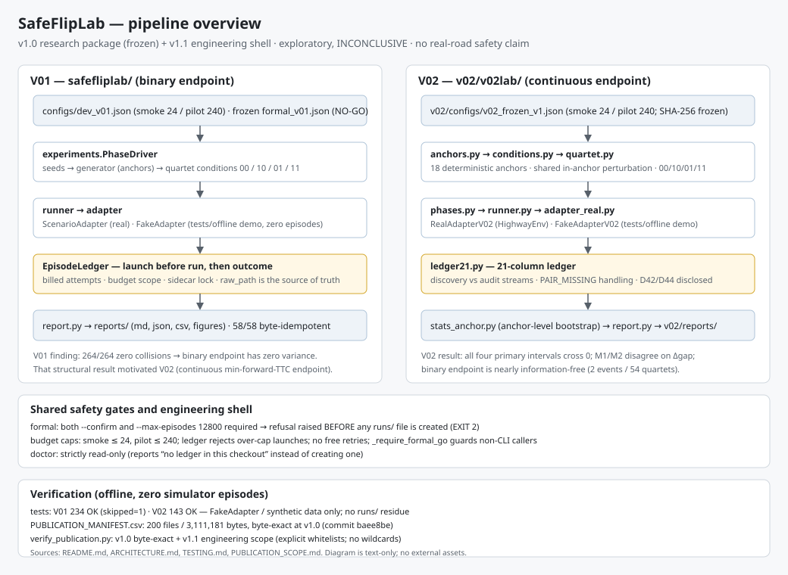
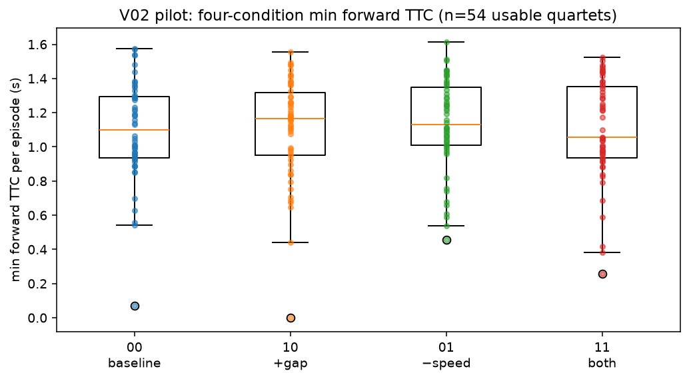
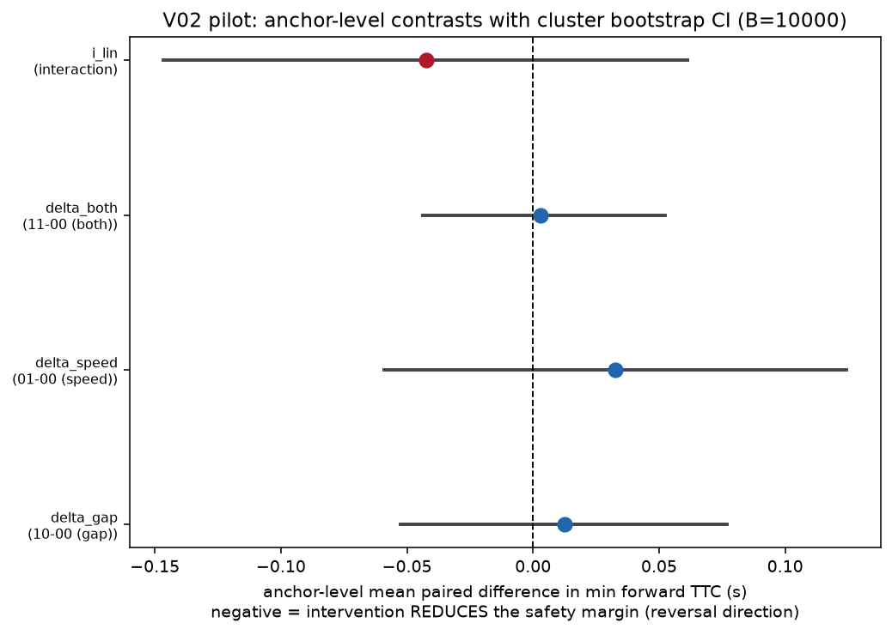
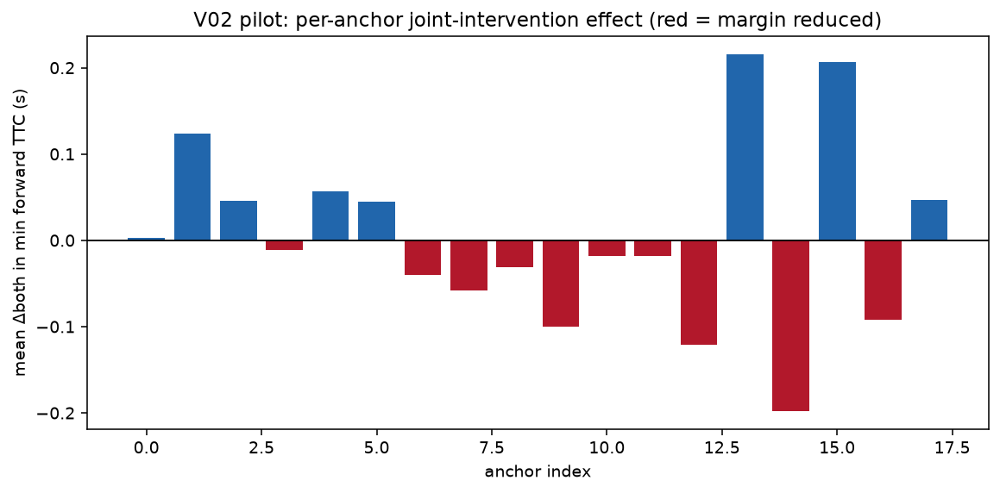
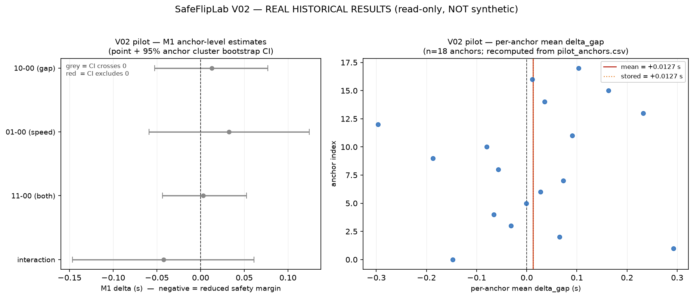

# SafeFlipLab（中文说明）

**面向简化自动驾驶仿真的、有预算约束的反事实安全反转测试。**

SafeFlipLab 既是**有预算约束的反事实安全评估工具**（在固定 episode 预算下
回答干预/反转问题的研究仪器），也是**可复现的研究工程产物**（账本优先计费、
字节级发布清单、零 episode 测试套件）。它**不是**安全认证工具。

SafeFlipLab 在同一个简化高速汇入仿真中（通过公开的 `cornercaselab==0.3.0`
接口驱动 HighwayEnv merge 场景，Apache-2.0）研究两个问题：

1. **反转问题。** 对一个规则控制器来说，**增大**初始前车间距
   （`front_gap += 2.0 m`）或**降低**自车初始速度（`ego_speed -= 1.0 m/s`），
   有没有可能反而**提高**仿真碰撞风险？两种干预叠加时是否存在非加性的
   风险交互？
2. **预算问题。** 在完全相同的 episode 预算下，"广泛探索"
   （`WideExplore`）与"先重复验证"（`VerifyFirst`）哪种方式提名的反直觉
   候选能通过**独立留出审计**？

所有结果都是简化仿真模型 + 一个冻结的观察式规则控制器的性质，
**不构成任何真实道路安全结论**。允许零结果，不预设正向发现。

## 它能做什么

- **提出反事实反转问题**：在冻结仿真器 + 冻结规则控制器上，用四条件配对
  设计（00 / 10 / 01 / 11）与锚级 bootstrap 区间回答干预问题。
- **每个 episode 可审计**：先计费后仿真、按 scope 的预算上限、无免费重试；
  失败尝试仍计费并如实披露（D37 是实例）。
- **独立审计提名**：留出审计流 + 方法相关种子；历史 D42/D44 的不独立性
  **如实披露而非隐藏**。
- **离线复现工程主张**：242 V01 + 143 V02 单元测试与字节级发布清单校验，
  **零**仿真 episode、**零** `runs/` 写入。
- **诚实阅读负结果**：四个主区间全部跨 0、M1/M2 在 Δgap 上方向相反、
  端点分辨率与效应同量级。

## 四条件反事实设计如何工作

反转问题采用 2×2 反事实设计。一个 **quartet** 是四次共享同一次扰动抽样、
只在两个冻结干预因子上变化的 episode：

| 因子 | 0（关） | 1（开） |
|---|---|---|
| `front_gap` | 基线 | `+2.0 m` |
| `ego_speed` | 基线 | `−1.0 m/s` |

```
2×2 反事实矩阵（一个 quartet = 四次共享扰动抽样的运行）

                  front_gap
            关(off)           +2.0 m
        ┌────────────────┬────────────────┐
        │       00       │       10       │   ego_speed 关(off)
        │    baseline    │    gap only    │
        ├────────────────┼────────────────┤
        │       01       │       11       │   ego_speed −1.0 m/s
        │   speed only   │   gap+speed    │
        └────────────────┴────────────────┘
```

由于同一 quartet 的四个单元共享同一次扰动抽样，配对差（`10−00`、`01−00`、
`11−00` 及其交互项）在 anchor 层级抵消共享噪声。**anchor**（冻结的场景/
控制器对）才是独立单元；95% 区间来自 18 个 anchor 的锚级 cluster bootstrap。

## 项目状态

| 项 | 状态 |
|---|---|
| 工程结题 | **PASS**——独立复算 141 项断言全过、manifest 闸门 PASS、doctor V01 17/17 + V02 7/7 GO、报告产物 58/58 逐字节幂等、账本全口径对账通过 |
| 科研结论 | **INCONCLUSIVE**（合法结题结果；探索性/描述性） |
| 测试（离线、零 episode） | **V01 242 OK (skipped=1)** / **V02 143 OK** |
| V01 formal（12,800 episodes） | **永久 NO-GO**——已实现、未获授权、从未运行 |
| 仓库可见性 | 以仓库设置为准 |

## 科学状态与限制

- V02 以探索性/描述性研究结题；两个主终点方向不一致（M1 最小前向 TTC 与
  M2 低 TTC 步占比在 Δgap 上方向相反，两者均为"更安全"方向的描述性观察），
  **保留并公开**，禁止跨终点比较符号；不产出 p 值、不作显著性声明；
  MDE=0.10 s 仅为样本量规划示例。
- V02 的二元碰撞端点在该设计中**近乎无信息**：**54 个 quartet 仅 2 次碰撞**
  （条件 `00`、`10` 各 1）；**`11` 一次未撞**（`reverse=0`、`rescue=1`——
  单一事件）。这正是 V02 改用连续端点的原因。
- 历史账本口径（属项目侧私有数据，见下节）：有效发起 **528**
  （V01 264 = smoke 24 + pilot 240；V02 264 = smoke 24 + pilot 240，
  其中 V02 smoke 含 1 个 error = D37）；历史真实发起合计 **748**
  （= 528 有效 + 220 作废首轮 pilot）。审计/方法比较在历史数据上不独立
  （D42/D44）：代码已修 ≠ 历史数据可作独立比较。

## 真实结果摘要（V02 pilot，真实数据）

来源：`v02/reports/pilot_report.md`——一次真实 HighwayEnv 运行（240 个已计费
episode、54 个可用 quartet、18 个 anchor）。纯描述；确证性抽样假设未成立，
**不产出任何 p 值**。

**M1——每 episode 最小前向 TTC（秒）。** 负 Δ = 干预降低了安全裕度
（反转方向）。

| 对比 | 含义 | 点估计 (s) | 95% 锚级 cluster bootstrap 区间 | 锚数 |
|---|---|---|---:|---:|
| delta_gap | 10−00（间距） | +0.0127 | [−0.0525, +0.0769] | 18 |
| delta_speed | 01−00（速度） | +0.0327 | [−0.0589, +0.1243] | 18 |
| delta_both | 11−00（双干预） | +0.0030 | [−0.0436, +0.0526] | 18 |
| i_lin | 交互项 | −0.0424 | [−0.1465, +0.0613] | 18 |

**M2——前向 TTC 低于低 TTC 阈值的步占比**（越小越安全，方向与 M1 相反，
D43）。各条件均值：`00` = 0.0234、`10` = 0.0252、`01` = 0.0127、
`11` = 0.0172。

**C13——二元碰撞端点**：54 个 quartet 共 2 次碰撞（`00` = 1、`10` = 1、
`01` = 0、`11` = 0）；`11` 一次未撞（`reverse` = 0、`rescue` = 1）。

四个 M1 区间**全部跨 0**：观测效应量与端点分辨率同量级，数据**不能支持
安全反转结论**。M1 与 M2 在 Δgap 上符号相反，如实披露而非调和。

## 关键图表

**架构**——纯文本管道图（V01/V02 + 安全门）：



**V02 pilot 真实结果图**——真实 HighwayEnv 数据，来自 `v02/reports/pilot/`：



*图 1：四条件 TTC 分布（真实 pilot 数据）。*



*图 2：锚级对比森林图（真实 pilot 数据）。*



*图 4：双干预逐锚 delta（真实 pilot 数据）。*

**结果汇总**——M1 森林图（锚级点估计 + 95% bootstrap 区间）与逐锚
`delta_gap` 散点，由 `examples/read_real_results.py` 只读生成：



*结果汇总：M1 四个区间全部跨 0（灰色），与 INCONCLUSIVE 结题一致。详见
`examples/read_real_results.py`。*

## CLI 速览

| 命令 | 作用 | 副作用 |
|---|---|---|
| `python -m safefliplab doctor` | 只读环境/接口检查（17 项） | **无**（从不创建账本） |
| `python -m safefliplab smoke --max-episodes 24` | 至多 24 个**真实计费** episode | 写 `runs/`；需负责人授权 |
| `python -m safefliplab pilot --max-episodes 240` | 至多 240 个**真实计费** episode | 写 `runs/`；需负责人授权 |
| `python -m safefliplab report --phase pilot` | 从账本重建报告产物 | 写 `reports/` |
| `python -m safefliplab formal --confirm --max-episodes 12800` | 仅准备 | **拒绝**（EXIT 2），且在任何文件创建前返回 |
| `cd v02 && python -m v02lab doctor` | V02 只读检查 | 无 |
| `python scripts/verify_publication.py` | 两级 manifest 校验 | 无 |

## 数据可用性声明（重要）

本快照**包含**：全部源码、测试、冻结/开发配置、阶段结果
汇总（`reports/`、`v02/reports/` 的报告/图/CSV/JSON）与结题文档。

本仓库**不包含**：原始 episode 级数据与账本——`runs/`、`v02/runs/`
（含每 episode 原始 JSON、`episode_ledger.csv*`、manifest 及作废首轮
`_buggy_pilot_run1/` 备份）。这些原始数据由项目负责人保存；确有需要者
可向项目负责人提出合理申请。

因此：

- `scripts/independent_verify_all.py`（独立复算器）的**完整重跑需要私有
  原始数据**（它只读账本 + 归档原始 episode JSON）；在本公开包范围内，
  复现性以**测试套件**（V01 242 + V02 143，合成数据/mock，不消耗真实
  episode）与**结果摘要**（reports/）为准。
- 原项目的 201 文件结题口径清单（`docs/FINAL_ARTIFACT_HASHES.csv` 等）
  记录了含 `runs/` 的完整集合；本发布包口径见 `RELEASE_NOTES.md` §2.3，
  两者独立记录、互不覆盖。原项目的 `scripts/build_final_manifest.py
  --check` 面向完整口径（含 runs/），**在本发布包内不适用**
  （会因缺少 runs/ 而失败）；本包的完整性校验以
  `PUBLICATION_MANIFEST.csv` + `scripts/verify_publication.py` 为准。

## 目录结构

```
safefliplab/     Python 包（适配器、生成器、运行器、账本、方法、统计、报告、CLI）
v02/v02lab/      V02 包（anchor、条件、TTC 状态、quartet、统计、报告、CLI）
configs/         dev_v01.json（smoke/pilot）与 formal_v01.json（正式冻结方案）
v02/configs/     v02_frozen_v1.json（V02 冻结协议）等
scripts/         辅助脚本（清单生成器、独立复算器、F-06 取证、发布校验器）
tests/           V01 单元测试（不消耗真实 episode；mock 只出现在测试里）
v02/tests/       V02 单元测试
reports/         V01 各阶段报告与图（只用真实数据）+ 结题报告/论文初稿（reports/v02/）
v02/reports/     V02 各阶段报告与图
docs/            协议、决策、进度、交接、指南、历轮验收证据、结题清单三件套
PUBLICATION_MANIFEST.csv   发布包完整性清单（相对路径/字节数/SHA-256）
RELEASE_NOTES.md           发布说明（含数据可用性与绝对路径披露）
LICENSE / CITATION.cff / pyproject.toml / requirements.txt
```

`report --phase <phase>` 产出（V01）：

```
<phase>_report.md          中文阶段报告（含预算账附录）
<phase>_episodes.csv|jsonl 每个已计费 episode 一行
<phase>_anchors.csv        每锚四条件计数/分母/比率/配对差值
<phase>_budget_summary.csv 预算 cap/launched/unused（失败/未知亦计费）
<phase>_comparisons.csv    每主种子的方法对比（不可计算时留空）
<phase>_quartets.csv       完整主 quartet 明细
<phase>_margins.csv        探索性连续裕度（非协议）
<phase>/figure_*.png       图表（仅在确有真实数据时生成）
```

## 快速开始（Windows + Python 3.13）

```powershell
python -m venv .venv
.\.venv\Scripts\python.exe -m pip install -e ".[sim]"
.\.venv\Scripts\python.exe -m safefliplab doctor
.\.venv\Scripts\python.exe -m unittest discover -s tests -v
```

预期输出 `Ran 242 tests, OK (skipped=1)`（227 个原有测试 + v1.1 新增的 7 个
副作用回归测试 + v1.2.0 新增的 8 个 CI 离线守卫测试）。唯一跳过项需要项目内的
旧版账本
（`runs/episode_ledger.csv`），发布快照不含该文件，属**设计性跳过**。
测试**不启动任何真实 episode**，也**不在仓库根写入 `runs/`**（GH-2 起，
`formal` 的拒绝路径在任何文件系统副作用之前返回）；若你的环境里仍残留
早前版本产生的 `runs/`（gitignored 测试产物），请先删除再重跑。

重跑 V02 测试（先进入 `v02/`，解释器仍用上一级的 `.venv`）：

```powershell
cd v02
..\.venv\Scripts\python.exe -m unittest discover -s tests -v
```

预期输出 `Ran 143 tests, OK`。

**CLI 安全警示**：`smoke`/`pilot` 会发起**真实计费 episode**（每个已发起
episode，含失败/中断，在启动前即计入账本，没有免费重试）；本快照不含账本，
如需运行仿真请先阅读 `docs/OWNER_GUIDE.zh-CN.md` 与
`docs/REPRODUCTION_MANUAL.zh-CN.md`。`formal` 阶段**仅准备**，必须有人工
GO，且本结题状态下为 NO-GO。

## 离线示例（不运行仿真）

```bash
python examples/offline_demo.py
```

用合成数据演示"四条件共享扰动 → 最小 TTC 对比"的最小闭环（FakeAdapter
语义；零 episode、零文件写入）。输出会明确标注
`SYNTHETIC OUTPUT - NOT EXPERIMENTAL RESULTS`，**不得**当作实验结果引用。
详见 `EXAMPLES.md` 与 `QUICKSTART.md`。

## 文档索引

| 文档 | 用途 |
|---|---|
| `INSTALLATION.md` | extras（`test` / `sim`）、平台差异、离线安装 |
| `QUICKSTART.md` | 5 分钟离线路径 |
| `ARCHITECTURE.md` | 模块图、账本/计费门、适配器、报告管道、安全门 |
| `docs/assets/architecture.svg` | 纯文本管道图（V01/V02 + 安全门） |
| `EXAMPLES.md` | 合成示例 + 如何阅读冻结结果 |
| `TESTING.md` | 命令、预期计数（242 / 143）、重复运行策略、CI |
| `DATA_AVAILABILITY.md` | 数据包含/不包含、528 vs 748、申请方式 |
| `CONTRIBUTING.md` | 硬性规则、代码风格、PR 清单 |
| `SECURITY.md` | 漏洞报告渠道、密钥策略、安全门 |
| `CHANGELOG.md` | v1.0、v1.1 与 v1.2.0 工程变更史 |
| `PUBLICATION_SCOPE.md` | v1.0 冻结研究包 vs v1.1/v1.2 工程范围 |
| `RELEASE_NOTES.md` | v1.0 发布说明：数据可用性、绝对路径披露、范围（§2.3） |
| `RELEASE_NOTES_v1.2.0.md` | v1.2.0（待发布）发布说明 |
| `scripts/ci_offline_guard.py` | 可执行离线守卫（拦截真实仿真启动模式） |
| `docs/`（冻结） | 结题证据：主张登记表、科研审计、账本对账 |

## 数据完整性与独立复算

- 本仓库每个文件的相对路径/字节数/SHA-256 记录于 `PUBLICATION_MANIFEST.csv；
  校验（任一行被篡改、文件增删均以非零退出失败）：

  ```powershell
  .\.venv\Scripts\python.exe scripts\verify_publication.py
  ```

- 独立复算器 `scripts/independent_verify_all.py` 只读账本与归档的原始
  episode JSON，不导入项目报告/统计模块，逐项重算全部已发布统计值
  （结题时 141 项断言全过）。其 `ROOT` 常量默认指向原项目路径
  （`SAFEFLIPLAB_ROOT` 环境变量可覆盖默认的仓库根），且**需要私有原始数据**
  才能完整运行。

## 可复现性

* 所有种子用 SHA-256 派生（`safefliplab/seeds.py`），不使用 Python `hash()`。
* `dev_seed = 20261011` 只用于 smoke/pilot；8 个正式 master seeds 冻结在
  `configs/formal_v01.json`（formal NO-GO，从未运行）。
* 每个已发起 episode（含失败、中断）在启动前即计入账本，没有免费重试
  （账本属私有数据，不在本包内）。
* 依赖固定见 `requirements.txt`（cornercaselab 0.3.0 来自固定的 GitHub tag、
  HighwayEnv 1.10.2、Gymnasium 1.2.2）。

## 许可与署名

SafeFlipLab 自身代码为 Apache-2.0（见 `LICENSE`）。仿真接口复用自
CornerCaseLab v0.3.0（Apache-2.0，作者 吴昊霖 / lin-lab666），以**安装依赖**
方式使用；HighwayEnv/Gymnasium 等保留各自许可（HighwayEnv MIT、Gymnasium
MIT、NumPy BSD-3-Clause、Pillow HPND、matplotlib license、pygame LGPL）。详见
`docs/PROVENANCE.md` 与 `docs/ATTRIBUTION.md`。

引用信息见 `CITATION.cff`。初学者导读：`docs/OWNER_GUIDE.zh-CN.md`。

## 获取帮助与贡献

- 问题 / 疑问：在本仓库的 Issue 中提出。请附命令、预期与实际输出、
  Python 版本，以及 `python -m safefliplab doctor` 的输出。
- 安全：通过 GitHub **security advisory** 私下报告（见 `SECURITY.md`），
  不要开公开 Issue。
- 贡献：先读 `CONTRIBUTING.md`。真实仿真 episode 需明确授权；冻结数据与
  结论不得改写。
